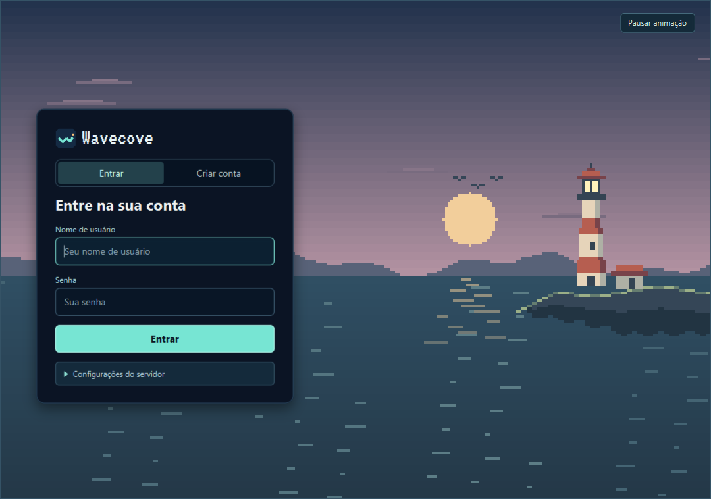

# Wavecove para navegador e Windows

Abra o [Wavecove Web](https://bate-papo-java.onrender.com/) para entrar com a mesma conta, conversar nos canais e acessar mensagens privadas. O servidor entrega a página e a API na mesma origem. Para executar localmente e consultar a análise de arquitetura, privacidade e operação, veja o [guia do cliente web](docs/WEB-E-ANALISE.md).

Aplicativo JavaFX em português com servidor Java/WebSocket. Cada pessoa cria uma conta e entra com seu usuário e senha para conversar em tempo real no mesmo canal.

O Wavecove combina um veleiro pixelado em mar noturno, ondas turquesa e luz âmbar com canais de conversa independentes. O cadastro tem uma animação própria. O cartão de acesso tem um degradê translúcido. O cenário anima automaticamente com a janela aberta, respeita a preferência de movimento do Windows e pausa quando a janela está minimizada. As mensagens e instruções usam fonte legível, com títulos e botões em estilo retrô. A fonte [VT323](https://github.com/google/fonts/tree/main/ofl/vt323) está incluída sob SIL Open Font License; veja `FONTE-LICENCA.txt` no pacote.



[Cadastro ao amanhecer](docs/previews/wavecove-registration.png) · [Conversa em um canal](docs/previews/wavecove-conversation.png)

## Abrir o aplicativo

Os pacotes gerados ficam em `dist/<data-hora>/`:

- `Wavecove-1.8.0.msi`: instalador para Windows x64, por usuário, com atalhos.
- `Wavecove-Windows-x64.zip`: versão portátil. Extraia **toda** a pasta e abra `Wavecove.exe`.
- `Wavecove/Wavecove.exe`: aplicativo já extraído nesta máquina.

Java está incluído no pacote. O servidor roda separadamente. `localhost` funciona somente no mesmo computador.

## Conectar ao servidor publicado

O servidor desta instalação está em **https://bate-papo-java.onrender.com**, no plano gratuito do workspace My Workspace.

1. Abra o Wavecove 1.8 e selecione **Criar conta**. Escolha um usuário de 3 a 24 caracteres (letras sem acento, números e sublinhado) e uma senha de 12 a 128 caracteres. Nas próximas vezes, escolha **Entrar**.
2. Peça à outra pessoa que crie a própria conta no mesmo servidor. O convite copiado em **Convidar pessoa** identifica o servidor e o canal.
3. Entre no canal indicado e procure a outra pessoa na lista de participantes. Use o endereço nas opções de conexão se precisar trocar de servidor.

O acesso por conta está disponível desde a versão 1.7. Apelidos das versões anteriores eram temporários. A primeira pessoa a cadastrar um nome passa a usá-lo com a própria senha.

## Criar canais e testar uma conversa

Após entrar, use **novo-canal** e **+** na lateral para criar e entrar em um canal. Clique em um canal da lista para trocar. Nomes têm de 2 a 24 letras minúsculas, números ou hífens (por exemplo `amigos` ou `projeto-java`). Todas as contas conectadas podem ver, criar e entrar nos canais. As chamadas de voz são privadas entre dois participantes.

Para testar no mesmo computador, abra duas janelas do Wavecove e entre com uma conta diferente em cada uma. Escolha o mesmo canal e envie uma mensagem em cada sentido.

Trocar de canal preserva rascunhos e histórico durante a sessão. O menu de contexto permite copiar mensagens e recuperar texto de envios recusados. Reiniciar o servidor encerra os canais temporários. As contas permanecem no banco.

Para apagar um texto, uma foto ou um vídeo que você enviou, abra **⋯ → Apagar mensagem…** e confirme em **Apagar**. O servidor verifica a autoria e remove o envio para quem usa a versão 1.8 no canal. A exclusão está disponível para os últimos 500 envios por canal. Quem já salvou um arquivo continua com sua cópia.

## Fotos e vídeos

Clique em **Anexar** no canal e selecione uma foto JPG ou PNG de até 5 MB (até 8 megapixels) ou um vídeo MP4 de até 15 MB. A outra pessoa pode usar **Ver foto**, **Salvar foto** ou **Baixar vídeo**. O vídeo abre no player do Windows depois de salvo.

Os arquivos ficam disponíveis para participantes autenticados no mesmo canal por até 30 minutos. Reiniciar o servidor apaga os arquivos. Salve no computador os anexos que quiser guardar.

## Chamadas privadas de voz

O Wavecove permite selecionar alguém no mesmo canal e ligar. A pessoa aceita ou recusa; o microfone só abre após o aceite. Há controles de silenciar e encerrar, indicação de conexão e duração. Sair, trocar de canal ou perder a conexão encerra a chamada; o chat não religa sozinho. Use fones e os dispositivos padrão de áudio do Windows.

O servidor deste projeto já está com TURN configurado. Em 17/11/2026, o diagnóstico nativo confirmou áudio sintético nos dois sentidos usando relay da Cloudflare. Falta a verificação humana com microfones e computadores em redes diferentes. Veja [ativação e diagnóstico](docs/VOICE-SETUP.md), [instruções de uso](docs/CHAMADAS-DE-VOZ.txt) e [evidências de validação](docs/VALIDACAO-1.4.md). Chamadas de até 55 minutos, uma por pessoa, sem gravação. Instale o Wavecove nos dois computadores. Instalações próprias sem TURN configurado mantêm o texto funcionando e informam voz indisponível.

O WebRTC nativo é fornecido por [webrtc-java 1.0.1](https://github.com/devopvoid/webrtc-java). Os JARs distribuídos mantêm `META-INF/LICENSE`, `META-INF/NOTICE` e as licenças dos componentes nativos em `META-INF/licenses/`.

## Compartilhar tela

Instalem a versão 1.8 nos dois computadores. Durante uma chamada conectada, escolha **Compartilhar tela**, selecione o monitor e confirme em **Compartilhar**. A outra pessoa pode abrir **Ver tela de…**, usar **Tamanho original** para ler texto pequeno ou pressionar **F11** para tela cheia. **Parar compartilhamento** encerra a transmissão do monitor e mantém a voz.

A captura prioriza a legibilidade de texto e está configurada para até 3840 × 2160 a 30 quadros por segundo, com limite de envio de 24 Mb/s. A qualidade recebida depende da resolução do monitor, dos computadores e da conexão.

## Desenvolvimento no Windows

Requer acesso à internet no primeiro preparo. No PowerShell, na pasta do projeto:

```powershell
.\scripts\bootstrap.ps1
.\scripts\maven.ps1 -B -ntp test
.\scripts\maven.ps1 -B -ntp package
.\scripts\start-server.ps1
```

O script inicia um banco de contas local em `%LOCALAPPDATA%\Wavecove\server`. Para usar PostgreSQL, configure `DATABASE_URL` no ambiente do servidor. Em outro terminal, abra o cliente:

```powershell
.\scripts\start-client.ps1
```

Nas opções de conexão, use `ws://localhost:8080` e cadastre uma conta diferente em cada janela. Para fechar o servidor iniciado no terminal, use Ctrl+C. Nenhum script muda a política de execução do Windows.

As ferramentas ficam no cache do usuário `%LOCALAPPDATA%\BatePapo\build-tools`, sem alteração global do PATH ou JAVA_HOME. O bootstrap verifica SHA-256 do JDK e SHA-512 do Maven. Dependências são resolvidas pelo Maven Central.

## Gerar distribuição

```powershell
.\scripts\package-windows.ps1
# Com WiX 3 no PATH ou em %LOCALAPPDATA%\BatePapo\build-tools\wix:
.\scripts\package-windows.ps1 -Installer
```

O script executa os testes antes de empacotar. `-SkipTests` serve para empacotar novamente um código que já foi verificado. Cada execução gera uma pasta nova e `SHA256SUMS.txt`. Não há assinatura digital comercial.

## Publicar na internet com Render

O projeto inclui `Dockerfile` e `render.yaml`. O servidor escuta `0.0.0.0:$PORT`, oferece `/health` e atende WebSocket em `/chat`. Use **uma única instância**.

1. Crie um projeto PostgreSQL dedicado. No Supabase, reserve um schema privado chamado `wavecove` e um usuário de banco exclusivo para o servidor, com permissão de criar tabelas apenas nesse schema. O cadastro e a autenticação rodam no servidor Java.
2. No Supabase, abra **Connect → Session pooler**. Use o host e a porta exibidos e o usuário no formato `role.project-ref`. Configure a URI PostgreSQL com TLS em `DATABASE_URL` nas variáveis privadas do serviço Render. No projeto só devem entrar arquivos de código.
3. Publique a imagem a partir deste repositório. Confira `/health`, cadastre duas contas de teste e verifique a troca de mensagens via WSS. O servidor cria as tabelas de contas no primeiro início. O endereço do banco e sua senha ficam no Render.
4. Distribua o cliente 1.8 para quem for conversar. O Blueprint usa publicação manual. A atualização de um servidor antigo requer o banco configurado antes do deploy.

O plano gratuito do Render suspende o serviço após 15 minutos sem tráfego e a primeira conexão após inatividade pode levar aproximadamente um minuto. Há cotas compartilhadas de uso, incluindo horas, builds e tráfego. Consulte o painel antes de publicar; a configuração deste projeto não contrata um plano pago. [Limitações oficiais](https://render.com/docs/free).

Para outro provedor, execute a imagem Docker atrás de um proxy HTTPS que aceite upgrade WebSocket. O TLS termina no provedor; o cliente verifica certificados normalmente. O aplicativo recusa `ws://` fora de loopback.

## Funcionamento e limites

- Até 20 canais (incluindo `geral`) e 64 conexões simultâneas no servidor, incluindo conexões ainda não autenticadas.
- Usuários de 3 a 24 caracteres. Cada nome é único, independentemente de maiúsculas e minúsculas. Uma conexão de chat por conta.
- Mensagens de até 2000 caracteres Unicode; 5 mensagens por segundo por cliente.
- Quadros JSON de até 16 KiB, filas limitadas e autenticação em até 10 segundos.
- Presença, heartbeat e reconexão com espera crescente de até 30 segundos.
- Mensagens pendentes expiram após 15 segundos sem confirmação. Não são reenviadas automaticamente.
- “Confirmada pelo servidor” não significa lida nem recebida por alguém que estava offline.
- Histórico somente na memória do cliente, até 500 itens por canal e 20 canais; sair ou fechar limpa a conversa.
- O banco guarda nomes de usuário e verificadores de senha com sal individual. O servidor processa as mensagens de texto. O histórico da conversa é temporário.

## Organização

| Caminho | Responsabilidade |
| --- | --- |
| `protocol` | Eventos JSON, validação e URLs seguras |
| `server` | Autenticação, canais, presença, filas e distribuição |
| `client` | Conexão assíncrona, reconexão e interface JavaFX |
| `scripts` | Ferramentas, execução e empacotamento Windows |
| `docs/VALIDACAO.md` | Evidências e limites da validação realizada |
| `docs/OCEAN-VALIDACAO.md` | Testes e conversa online da versão 1.3.0 |

JDK 21.0.13, JavaFX 21.0.13, Javalin 7.2.4, Jackson 2.23.0 e Maven 3.10.1. A imagem de build usa Maven 3.9.11 com JDK 21; o POM é compatível com ambos. O teste da interface roda somente no Windows; os demais testes também rodam no contêiner Linux.

## Diagnóstico

- **Reconectando:** confira URL, conexão e estado do serviço; aguarde a inicialização de uma instância gratuita.
- **Usuário ou senha incorretos:** confira o usuário, a senha e o endereço do servidor em que fez o cadastro.
- **Usuário já cadastrado:** use Entrar se a conta é sua, ou escolha outro usuário. Se já estiver conectado em outro computador, saia da sessão anterior.
- **Não abre ao copiar o EXE:** use o instalador ou mantenha as pastas `app` e `runtime` junto do EXE.
- **Entrega não confirmada:** a mensagem pode ter chegado; decida antes de reenviá-la manualmente.

Referências: [JavaFX](https://openjfx.io/), [WebSocket Java](https://docs.oracle.com/en/java/javase/21/docs/api/java.net.http/java/net/http/WebSocket.html), [Javalin](https://javalin.io/documentation), [jpackage](https://docs.oracle.com/en/java/javase/21/jpackage/packaging-overview.html), [Render WebSocket](https://render.com/docs/websocket).

Análise das melhorias e limites: [ANALISE-1.3.md](docs/ANALISE-1.3.md).
