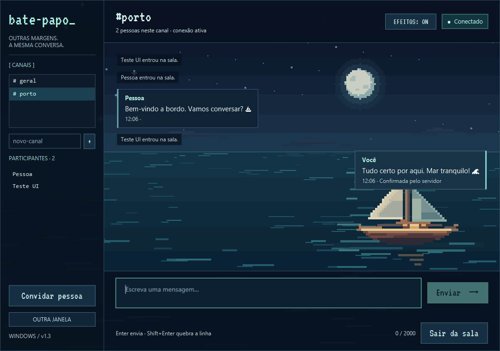

# Bate-papo para Windows

Aplicativo JavaFX em português com servidor Java/WebSocket. Duas pessoas conectam ao mesmo servidor, com o mesmo código de acesso e apelidos diferentes, para conversar em tempo real.

O cliente Windows 1.4 combina um veleiro pixelado em mar noturno, ondas turquesa e luz âmbar com canais de conversa independentes. **EFEITOS: ON/OFF** pausa ou retoma a animação; minimizar, desconectar e sair também interrompem o movimento. As mensagens e instruções usam fonte legível, com títulos e botões em estilo retrô. A fonte [VT323](https://github.com/google/fonts/tree/main/ofl/vt323) está incluída sob SIL Open Font License; veja `FONTE-LICENCA.txt` no pacote.



## Abrir o aplicativo

Os pacotes gerados ficam em `dist/<data-hora>/`:

- `BatePapo-1.4.0.msi`: instalador para Windows x64, por usuário, com atalhos.
- `BatePapo-Windows-x64.zip`: versão portátil. Extraia **toda** a pasta e abra `BatePapo.exe`.
- `BatePapo/BatePapo.exe`: aplicativo já extraído nesta máquina.

Java está incluído no pacote. O servidor roda separadamente. `localhost` funciona somente no mesmo computador.

## Conectar ao servidor publicado

O servidor desta instalação está em **https://bate-papo-java.onrender.com**, no plano gratuito do workspace My Workspace.

1. Nos dois computadores, abra o aplicativo. O servidor já está preenchido; para verificar ou alterar, expanda **Servidor e diagnóstico de conexão**.
2. No [painel do serviço no Render](https://dashboard.render.com/web/srv-dbu51hrm8hqs73e50qgg), abra **Environment** e copie o valor de `CHAT_ACCESS_TOKEN` para o campo **Código de acesso**. Compartilhe esse código em particular com a outra pessoa.
3. O aplicativo sugere um apelido válido. Se o nome estiver ocupado, clique em **Gerar outro** e tente de novo; o código será mantido nessa falha.

O código não está neste repositório nem no instalador. A publicação foi criada diretamente no Render; não é necessário criar outro serviço pelo Blueprint abaixo. Publicações automáticas estão desativadas.

## Criar canais e testar uma conversa

Após entrar, use **novo-canal** e **+** na lateral para criar e entrar em um canal. Clique em um canal da lista para trocar. Nomes têm de 2 a 24 letras minúsculas, números ou hífens (por exemplo `amigos` ou `projeto-java`). Todos com o código compartilhado podem ver, criar e entrar nos canais; canais separam conversas, não são grupos com senhas próprias.

**OUTRA JANELA** abre uma segunda sessão para teste no mesmo computador. Preencha o mesmo código, use outro apelido e escolha o mesmo canal nas duas janelas. Envie uma mensagem em cada sentido. Depois teste com a outra pessoa em outro computador usando os mesmos dados.

Trocar de canal preserva rascunhos e histórico separado durante a sessão. **Convidar pessoa** copia o servidor e o canal; envie o código separadamente. **Verificar servidor** consulta a saúde HTTP, sem validar o código nem substituir a conexão WSS. Você pode copiar mensagens pelo menu de contexto e recuperar o texto de envios recusados. Os canais são temporários e desaparecem se o servidor reiniciar; nesse caso o aplicativo retorna a `geral`. Clientes 1.0/1.1 continuam conversando em `geral`; use 1.2 para acessar os novos canais.

## Chamadas privadas de voz

A versão 1.4 permite selecionar alguém no mesmo canal e ligar. A pessoa aceita ou recusa; o microfone só abre após o aceite. Há controles de silenciar e encerrar, indicação de conexão e duração. Sair, trocar de canal ou perder a conexão encerra a chamada; o chat não religa sozinho. Use fones e os dispositivos padrão de áudio do Windows.

O servidor precisa do TURN configurado. Sem isso, o aplicativo informa voz indisponível e mantém o texto funcionando. Veja [ativação e diagnóstico](docs/VOICE-SETUP.md) e [instruções de uso](docs/CHAMADAS-DE-VOZ.txt). Chamadas de até 55 minutos, uma por pessoa, sem gravação. Instale 1.4 nos dois computadores; versões anteriores continuam compatíveis para texto.

O WebRTC nativo é fornecido por [webrtc-java 1.0.1](https://github.com/devopvoid/webrtc-java). Os JARs distribuídos mantêm `META-INF/LICENSE`, `META-INF/NOTICE` e as licenças dos componentes nativos em `META-INF/licenses/`.

## Desenvolvimento no Windows

Requer acesso à internet no primeiro preparo. No PowerShell, na pasta do projeto:

```powershell
.\scripts\bootstrap.ps1
.\scripts\maven.ps1 -B -ntp test
.\scripts\maven.ps1 -B -ntp package
.\scripts\start-server.ps1
```

O servidor pede um código de acesso de 24 a 128 caracteres se `CHAT_ACCESS_TOKEN` não estiver definida. Use um código aleatório. Em outro terminal, abra duas instâncias:

```powershell
.\scripts\start-client.ps1
```

Preencha `ws://localhost:8080`, o código escolhido e um apelido diferente em cada janela. Para fechar o servidor iniciado no terminal, use Ctrl+C. Nenhum script muda a política de execução do Windows.

As ferramentas ficam no cache do usuário `%LOCALAPPDATA%\BatePapo\build-tools`, sem alteração global do PATH ou JAVA_HOME. O bootstrap verifica SHA-256 do JDK e SHA-512 do Maven. Dependências são resolvidas pelo Maven Central.

## Gerar distribuição

```powershell
.\scripts\package-windows.ps1
# Com WiX 3 no PATH ou em %LOCALAPPDATA%\BatePapo\build-tools\wix:
.\scripts\package-windows.ps1 -Installer
```

O script executa os testes antes de empacotar. `-SkipTests` serve para empacotar novamente um código que já foi verificado. Cada execução gera uma pasta nova e `SHA256SUMS.txt`. Não há assinatura digital comercial.

## Publicar na internet com Render

O projeto inclui `Dockerfile` e `render.yaml`. O servidor escuta `0.0.0.0:$PORT`, oferece `/health` e atende WebSocket em `/chat`. Use **uma única instância**.

1. Envie este código para um repositório GitHub/GitLab/Bitbucket acessível ao Render. Não envie `.local`, `.tools`, `dist`, `target` ou segredos.
2. No Render, crie um Blueprint a partir desse repositório. Revise o serviço `bate-papo-java`, com plano `free` e Docker.
3. O Blueprint gera `CHAT_ACCESS_TOKEN` automaticamente. No painel do Render, copie o valor para os dois aplicativos e compartilhe-o somente com as pessoas convidadas. Não inclua o código na URL.
4. Aguarde o serviço ficar disponível; verifique `https://<seu-serviço>.onrender.com/health`.
5. Nos dois aplicativos, use `https://<seu-serviço>.onrender.com` (convertido para WSS automaticamente), o mesmo código e apelidos diferentes.
6. Confirme a conversa com os computadores em redes distintas. Reinícios do servidor causam reconexão e perda de mensagens enviadas durante a ausência.

O Blueprint desativa publicações automáticas; novos commits requerem deploy manual. Para trocar o código, atualize `CHAT_ACCESS_TOKEN` no painel e publique novamente; as pessoas precisarão do novo código.

O plano gratuito do Render suspende o serviço após 15 minutos sem tráfego e a primeira conexão após inatividade pode levar aproximadamente um minuto. Há cotas compartilhadas de uso, incluindo horas, builds e tráfego. Consulte o painel antes de publicar; a configuração deste projeto não contrata um plano pago. [Limitações oficiais](https://render.com/docs/free).

Para outro provedor, execute a imagem Docker atrás de um proxy HTTPS que aceite upgrade WebSocket. O TLS termina no provedor; o cliente verifica certificados normalmente. O aplicativo recusa `ws://` fora de loopback.

## Funcionamento e limites

- Até 20 canais (incluindo `geral`) e 64 conexões simultâneas no servidor, incluindo conexões ainda não autenticadas.
- Apelidos de 2 a 24 caracteres; nomes iguais, sem distinção de maiúsculas, não entram simultaneamente.
- Mensagens de até 2000 caracteres Unicode; 5 mensagens por segundo por cliente.
- Quadros JSON de até 16 KiB, filas limitadas e autenticação em até 10 segundos.
- Presença, heartbeat e reconexão com espera crescente de até 30 segundos.
- Mensagens pendentes expiram após 15 segundos sem confirmação. Não são reenviadas automaticamente.
- “Confirmada pelo servidor” não significa lida nem recebida por alguém que estava offline.
- Histórico somente na memória do cliente, até 500 itens por canal e 20 canais; sair ou fechar limpa a conversa.
- Não há cadastro, transferência de arquivos ou banco de dados. O texto não tem criptografia de ponta a ponta: o servidor processa as mensagens. Apelidos não comprovam identidade.

## Organização

| Caminho | Responsabilidade |
| --- | --- |
| `protocol` | Eventos JSON, validação e URLs seguras |
| `server` | Autenticação, canais, presença, filas e distribuição |
| `client` | Conexão assíncrona, reconexão e interface JavaFX |
| `scripts` | Ferramentas, execução e empacotamento Windows |
| `docs/VALIDACAO.md` | Evidências e limites da validação realizada |
| `docs/OCEAN-VALIDACAO.md` | Testes e conversa online da versão 1.3.0 |

JDK 21.0.13, JavaFX 21.0.13, Javalin 7.2.4, Jackson 2.23.0 e Maven 3.10.1. A imagem de build usa Maven 3.9.11 com JDK 21; o POM é compatível com ambos. O teste da interface roda somente no Windows; os demais testes também rodam no contêiner Linux.

## Diagnóstico

- **Reconectando:** confira URL, conexão e estado do serviço; aguarde a inicialização de uma instância gratuita.
- **Código incorreto:** copie novamente o código configurado no servidor, sem espaços extras.
- **Apelido em uso:** escolha outro. A reconexão automática só substitui a sessão que pertence à mesma instância do aplicativo.
- **Não abre ao copiar o EXE:** use o instalador ou mantenha as pastas `app` e `runtime` junto do EXE.
- **Entrega não confirmada:** a mensagem pode ter chegado; decida antes de reenviá-la manualmente.

Referências: [JavaFX](https://openjfx.io/), [WebSocket Java](https://docs.oracle.com/en/java/javase/21/docs/api/java.net.http/java/net/http/WebSocket.html), [Javalin](https://javalin.io/documentation), [jpackage](https://docs.oracle.com/en/java/javase/21/jpackage/packaging-overview.html), [Render WebSocket](https://render.com/docs/websocket).

Análise das melhorias e limites: [ANALISE-1.3.md](docs/ANALISE-1.3.md).
